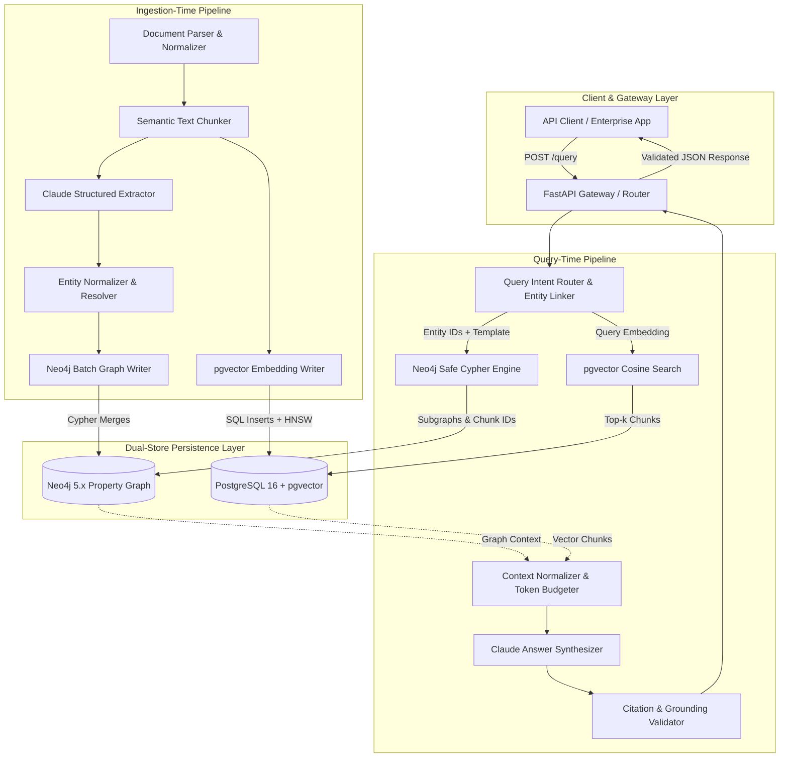
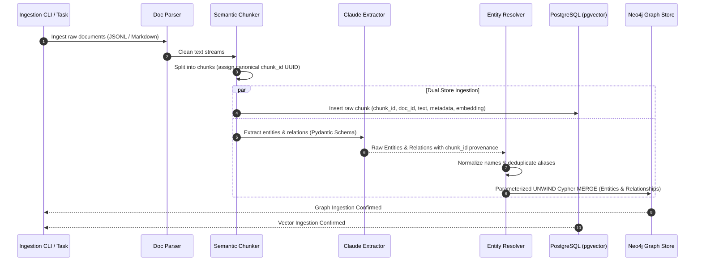
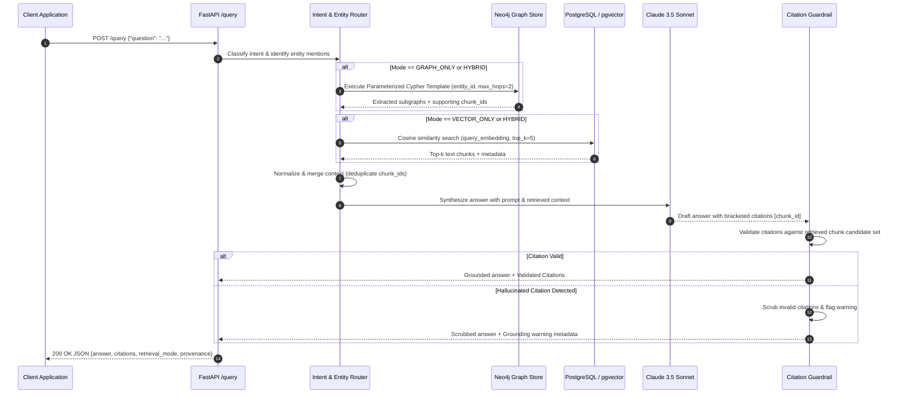

# System Architecture Specification

---

## 1. High-Level System Architecture

The Knowledge Graph RAG platform implements a modular, service-oriented architecture separating **Ingestion-Time Processing** from **Query-Time Processing**, connected via dual-storage persistence (Neo4j and PostgreSQL/pgvector).

---

## 2. Ingestion-Time Sequence Flow

The ingestion pipeline transforms raw enterprise documents into structured graph entities and dense vector embeddings while preserving exact chunk-level provenance.

---

## 3. Query-Time Sequence Flow

The query execution pipeline classifies incoming queries, retrieves relevant subgraphs and text chunks, synthesizes a grounded answer, and validates citations prior to returning the response.

---

## 4. Component Responsibilities & Interface Boundaries

### 1. Document Ingestion & Chunking Engine (`src/ingest/`)
- **Responsibilities**: Tokenizes documents into fixed/semantic chunk boundaries, computes SHA-256 document content hashes, generates canonical UUID `chunk_id`s, and orchestrates extraction.
- **Interfaces**: Outputs `DocumentChunk` Pydantic models containing `chunk_id`, `document_id`, `content`, `metadata`, and character offset ranges.

### 2. Structured LLM Extractor & Entity Resolver (`src/extraction/`)
- **Responsibilities**: Submits text chunks to Claude using strict Pydantic tool-calling schemas. Normalizes entity surface forms (e.g., `"Postgres"`, `"PostgreSQL"`, `"PostgreSQL 16"` $\rightarrow$ `"PostgreSQL"`).
- **Interfaces**: Emits `ExtractedGraph` objects containing lists of `EntityNode` and `RelationshipEdge` with source `chunk_id` provenance.

### 3. Dual Storage Adapters (`src/db/`)
- **Neo4j Adapter (`src/db/neo4j.py`)**: Manages Cypher connection pooling, uniqueness constraints, index management, and parameterized transactional writes.
- **PostgreSQL Adapter (`src/db/postgres.py`)**: Manages SQLAlchemy/asyncpg connections, pgvector HNSW indexing, chunk insertion, and cosine distance queries.

### 4. Query Intent Router & Entity Linker (`src/routing/`)
- **Responsibilities**: Evaluates query syntax and semantic intent. Classifies query into `GRAPH_ONLY`, `VECTOR_ONLY`, `HYBRID`, or `OUT_OF_SCOPE`. Extracts seed entity candidates for graph entry points.
- **Interfaces**: Emits `RoutingDecision` model containing `mode`, `confidence`, `seed_entities`, and `selected_template`.

### 5. Safe Cypher Query Engine (`src/retrieval/graph_retriever.py`)
- **Responsibilities**: Maps query intent and linked entities to pre-audited Cypher query templates. Enforces maximum traversal depth limits ($D \le 3$) and node count bounds.
- **Security Invariant**: Never executes arbitrary Cypher strings.

### 6. Vector Retrieval Engine (`src/retrieval/vector_retriever.py`)
- **Responsibilities**: Embeds incoming queries and executes cosine distance search in PostgreSQL using `pgvector` HNSW indexes. Applies metadata pre-filtering where specified.

### 7. Answer Synthesis & Citation Validator (`src/synthesis/`)
- **Responsibilities**: Assembles retrieved subgraphs and text chunks into a structured prompt. Invokes Anthropic Claude to generate a grounded response. Validates that every citation in the response references an actual retrieved `chunk_id`.

### 8. FastAPI Application Service (`src/api/`)
- **Responsibilities**: Exposes REST interfaces, request validation, CORS, error handling, request ID injection, and structured telemetry logging.

---

## 5. Dual-Store Invariant & Failure Isolation

### The Shared `chunk_id` Invariant
Both database systems rely on an identical, immutable `chunk_id` (UUID v4):
- In **PostgreSQL**: `chunks.id = 'a1b2c3d4-...'` is the primary key of the raw text and embedding vector.
- In **Neo4j**: `(e:Entity)-[r:RELATION {source_chunk_ids: ['a1b2c3d4-...']}]->(target)` references the exact chunk supporting the relationship.

### Failure Isolation & Reconciliation
Because distributed transactions across Neo4j and PostgreSQL are not natively atomic:
1. **Ingestion Failure Handling**: If PostgreSQL insertion succeeds but Neo4j fails (or vice versa), the ingestion job logs the failure and marks the document status as `FAILED_INGESTION` in a reconciliation table. Re-running the ingestion job uses deterministic upsert logic (`ON CONFLICT DO UPDATE` in PostgreSQL, `MERGE` in Neo4j) to restore consistency.
2. **Query-Time Graceful Degradation**: If Neo4j is unavailable during query execution, the router automatically degrades to `VECTOR_ONLY` retrieval, setting `degraded: true` and `degradation_reason: "Neo4j unavailable"` in the API response metadata.

---

## 6. Architectural Trade-offs & Alternatives Considered

| Decision Area | Selected Approach | Alternative Considered | Trade-off Rationale |
| :--- | :--- | :--- | :--- |
| **Graph Query Generation** | Fixed Parameterized Cypher Templates | Dynamic LLM Text-to-Cypher | Dynamic Cypher is prone to syntax hallucinations, runaway Cartesian traversals, and Cypher injection attacks. Parameterized templates guarantee safety and predictable performance. |
| **Vector Storage** | PostgreSQL + pgvector | Dedicated Vector DB (e.g. Pinecone, Qdrant) | Storing relational metadata, documents, chunks, and embeddings within a single PostgreSQL database simplifies operational complexity, backups, and transactional consistency. |
| **Framework Layer** | Lightweight Custom Pipelines + Selective LangChain | Heavy All-in-One Frameworks (e.g., LangChain/LlamaIndex end-to-end) | Direct, typed Python code ensures full control over citation validation, error isolation, telemetry, and prevents framework abstraction churn. |
